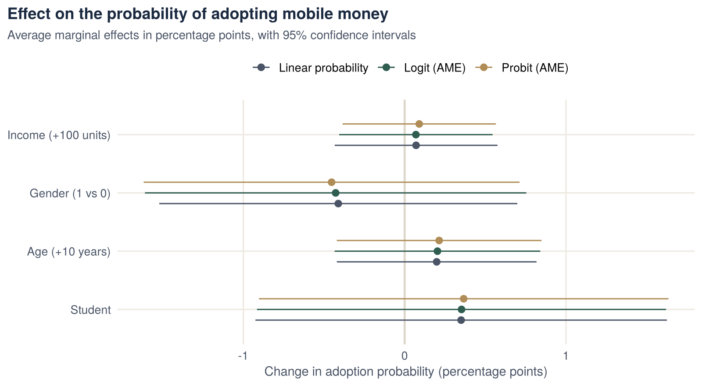

::: {.project-meta}
::: {}
[Context]{.k}

[MSc Econometrics, HU Berlin]{.v}
:::
::: {}
[Data]{.k}

[Cross-section, 1,000 individuals]{.v}
:::
::: {}
[Method]{.k}

[LPM, logit, probit, average marginal effects]{.v}
:::
::: {}
[Tools]{.k}

[R · glm · margins · pscl]{.v}
:::
:::

## Key findings

- **The three models agree.** The linear probability model, logit and probit give nearly identical average marginal effects for every variable.
- **No characteristic significantly predicts adoption.** All four covariates are individually insignificant, and jointly insignificant too (likelihood-ratio test p ≈ 0.90).
- **The binding constraint is the data, not the method.** Only **8 of 1,000** individuals (0.8%) adopted mobile money, which leaves very little information to estimate effects.
- **Accuracy can mislead.** The logit model classifies 99.2% of cases correctly. A model that simply predicts "no adoption" for everyone achieves the same accuracy, so accuracy is uninformative when the outcome is this rare.

## Research question

Mobile money is an important channel of financial inclusion, especially in rural and low-income settings. Knowing who adopts it helps target policies such as information campaigns or agent networks. The project estimates how income, gender, age and student status relate to the probability of adoption.

## Data

The data are a course dataset of **1,000 individuals**.

| Variable | Description | Mean |
|---|---|---:|
| `adopt` | Adopted mobile money (1/0), the outcome | 0.008 |
| `income` | Income | 206.3 |
| `gender` | Gender dummy (1/0) | 0.49 |
| `age` | Age in years | 38.0 |
| `student` | Student (1/0) | 0.33 |

## Methodology

Three models of $P(\text{adopt}_i = 1 \mid X_i)$:

- **Linear probability model (LPM):** OLS on the 0/1 outcome. Simple to interpret, but predicted probabilities can fall outside [0, 1].
- **Logit:** $P = \Lambda(X_i'\beta)$, where $\Lambda$ is the logistic function.
- **Probit:** $P = \Phi(X_i'\beta)$, where $\Phi$ is the standard normal distribution function.

Logit and probit coefficients are not directly comparable with each other or with the LPM. I therefore computed **average marginal effects (AMEs)**: the average change in adoption probability for a one-unit change in each variable. Model fit is compared with McFadden's pseudo-R² and AIC.

## Results

### Average marginal effects

| Change in adoption probability (percentage points) | LPM | Logit AME | Probit AME |
|---|---:|---:|---:|
| Income (+100 units) | 0.07 | 0.07 | 0.09 |
| Gender (1 vs. 0) | −0.41 | −0.43 | −0.45 |
| Age (+10 years) | 0.20 | 0.20 | 0.21 |
| Student | 0.35 | 0.35 | 0.37 |

[No estimate is significant at the 10% level (all p > 0.4). Logit and probit AMEs with delta-method standard errors.]{.muted style="font-size:.88rem"}

{fig-alt="Average marginal effects from LPM, logit and probit; all three agree and all confidence intervals include zero."}

### Model fit

| | Logit | Probit |
|---|---:|---:|
| Log-likelihood | −46.08 | −46.04 |
| McFadden pseudo-R² | 0.011 | 0.012 |
| AIC | 102.2 | 102.1 |
| LR test of all covariates (χ², 4 df) | 1.03 (p = 0.90) | 1.11 (p = 0.89) |

## Economic interpretation

- **No detectable relationship.** With an adoption rate below 1%, none of the characteristics explains who adopts. The effects are small, at most half a percentage point. The confidence intervals cannot rule out either small positive or small negative effects.
- **Model choice matters little here.** All three estimators give practically the same marginal effects. For effects on probabilities averaged over the sample, the choice between LPM, logit and probit is often less important than it appears. The key is to compare marginal effects, not raw coefficients.
- **Rare outcomes need a different approach.** To study who adopts a new technology at such an early stage, a researcher would need more adopters. Options include oversampling adopters, collecting data in a later phase of diffusion, or using estimators designed for rare events. High classification accuracy should not be read as evidence of a good model.

## What this project demonstrates

- Estimating and comparing linear probability, logit and probit models in R.
- Computing and interpreting average marginal effects instead of raw coefficients.
- Assessing fit with pseudo-R², AIC and likelihood-ratio tests.
- Reporting a null result honestly and identifying its cause.

## Code

Full analysis script: [`binary_choice.R`](scripts/binary_choice.R)

[The dataset was provided for the course and is not redistributed here.]{.muted style="font-size:.88rem"}
