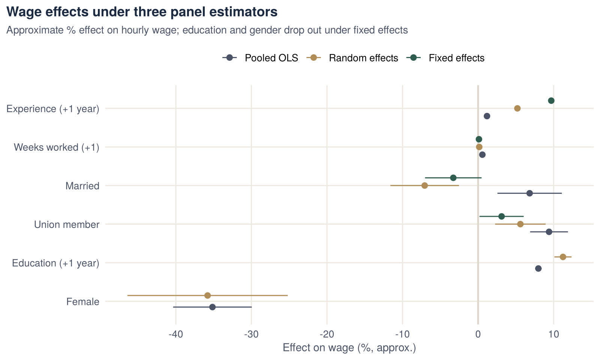

::: {.project-meta}
::: {}
[Context]{.k}

[MSc Econometrics, HU Berlin]{.v}
:::
::: {}
[Data]{.k}

[Balanced panel: 595 workers × 7 years]{.v}
:::
::: {}
[Method]{.k}

[Pooled OLS, FE, RE, LM / F / Hausman tests]{.v}
:::
::: {}
[Tools]{.k}

[R · plm · lmtest · readxl]{.v}
:::
:::

## Key findings

- **Unobserved individual differences matter a lot.** Stable worker characteristics account for **78% of the unexplained variation** in wages.
- **The tests favour fixed effects.** The LM test rejects pooled OLS in favour of random effects. The Hausman test then rejects random effects in favour of fixed effects (χ² = 7,718, p < 0.001).
- **Results change once stable characteristics are controlled for.** Under fixed effects:
  - the union wage premium falls from 9.4% to **3.1%**;
  - the marriage premium turns slightly negative;
  - wage growth with experience rises to about **10% per year**.
- **Education and gender cannot be estimated under fixed effects.** They never change within a person over the seven years.

## Research question

Wages depend on observable characteristics, such as experience or union membership, and on unobservable ones, such as ability and motivation. When the unobserved traits are correlated with the regressors, cross-section estimates are biased. Panel data let us control for such traits as long as they are constant over time. The project asks:

1. How do experience, weeks worked, marital status and union membership affect wages?
2. Which estimator is appropriate: pooled OLS, random effects or fixed effects?

## Data

The data are a **balanced panel of 595 individuals observed for 7 years**, giving 4,165 observations, with no missing values. The data are the Cornwell and Rupert extract of the US Panel Study of Income Dynamics.

| Variable | Description | Varies over time for |
|---|---|---:|
| `lwage` | Log hourly wage (outcome) | 100% of individuals |
| `exp` | Years of work experience | 100% |
| `wks` | Weeks worked in the year | 98% |
| `union` | Union membership (1/0) | 14% |
| `ms` | Married (1/0) | 8% |
| `ed` | Years of education | 0% |
| `fem` | Female (1/0) | 0% |

**Panel checks before estimation:**

- I confirmed there is one row per person and year.
- I computed, for each variable, the share of individuals whose value changes over time (last column above).
- This matters for the choice of estimator. Fixed effects use only changes *within* a person, so they cannot estimate variables that never change, like education and gender. Variables that change for few people, like union membership and marital status, are estimated less precisely.

## Methodology

$$
\ln w_{it} = \beta_1 \text{exp}_{it} + \beta_2 \text{wks}_{it} + \beta_3 \text{ed}_{i} + \beta_4 \text{fem}_{i} + \beta_5 \text{ms}_{it} + \beta_6 \text{union}_{it} + \alpha_i + \varepsilon_{it}
$$

Here $\alpha_i$ is an unobserved, time-constant individual effect, such as ability. The three estimators treat it differently:

- **Pooled OLS** ignores $\alpha_i$. It is biased if $\alpha_i$ is correlated with the regressors.
- **Random effects (RE)** treat $\alpha_i$ as random and uncorrelated with the regressors. This is efficient if the assumption holds.
- **Fixed effects (FE)** remove $\alpha_i$ by comparing each person with themselves over time. This is consistent even if $\alpha_i$ is correlated with the regressors.

**Choosing between them:**

1. Breusch–Pagan LM test: pooled OLS vs. RE.
2. F-test for individual effects: pooled OLS vs. FE.
3. Hausman test: RE vs. FE.

## Results

### Estimates

| | Pooled OLS | Random effects | Fixed effects |
|---|---:|---:|---:|
| Experience | 0.0118*** | 0.0520*** | **0.0968**\*\*\* |
| Weeks worked | 0.0056*** | 0.0015* | 0.0011· |
| Education | 0.0798*** | 0.1123*** | — |
| Female | −0.3516*** | −0.3580*** | — |
| Married | 0.0682** | −0.0707** | −0.0328· |
| Union member | 0.0939*** | 0.0559** | **0.0311**\* |
| Observations | 4,165 | 4,165 | 4,165 |

[\*\*\* p < 0.001, \*\* p < 0.01, \* p < 0.05, · p < 0.1. Coefficients are effects on log wage; × 100 ≈ % effect. "—": not identified under fixed effects (constant within individuals).]{.muted style="font-size:.88rem"}

{fig-alt="Coefficient plot comparing pooled OLS, random effects and fixed effects estimates for six wage determinants."}

### Model selection

| Test | Comparison | Statistic | p-value | Conclusion |
|---|---|---:|---:|---|
| Breusch–Pagan LM | Pooled OLS vs. RE | χ² = 4,233 | < 0.001 | Individual effects exist; pooled OLS is rejected |
| F-test | Pooled OLS vs. FE | F = 35.5 | < 0.001 | Individual effects are jointly significant |
| Hausman | RE vs. FE | χ² = 7,719 | < 0.001 | RE is inconsistent; **use fixed effects** |

**Random-effects variance decomposition:**

- individual effects account for **78%** of the error variance;
- the idiosyncratic error accounts for 22%;
- θ = 0.81, which means RE is already close to FE.

## Economic interpretation

- **Experience.** Within a person, an extra year of experience is associated with about 10% higher wages. Because experience rises by one year for everyone each year, this estimate also captures general wage growth over the period. It is therefore best read as a person's total wage growth per year.
- **Unions.** The union premium falls from about 9% in pooled OLS to about 3% under fixed effects. Much of the raw union premium therefore reflects *which* workers join unions, not what unions pay.
- **Marriage.** The positive marriage premium in pooled OLS disappears under fixed effects. This is consistent with selection: workers with higher earning potential are more likely to be married.
- **Education and gender.** Pooled OLS and RE suggest about 8–11% higher wages per year of education, and a 35% lower wage for women. These estimates are not identified under FE, so they rest on the stronger RE assumption that individual effects are uncorrelated with the regressors. The Hausman test rejects that assumption.
- **General lesson.** Controlling for unobserved, time-constant individual characteristics substantially changes policy-relevant estimates, such as the union and marriage premiums. Choosing the estimator with formal tests is essential.

## What this project demonstrates

- Setting up and checking panel data, including identifying which variables vary over time.
- Estimating pooled OLS, fixed-effects and random-effects models in R with `plm`.
- Choosing an estimator with LM, F and Hausman tests.
- Explaining how and why estimates change across estimators.

## Code

Full analysis script: [`panel_wages.R`](scripts/panel_wages.R)

[Data: Cornwell, C. and Rupert, P. (1988). Efficient estimation with panel data: an empirical comparison of instrumental variables estimators. *Journal of Applied Econometrics*, 3(2), 149–155.]{.muted style="font-size:.88rem"}
