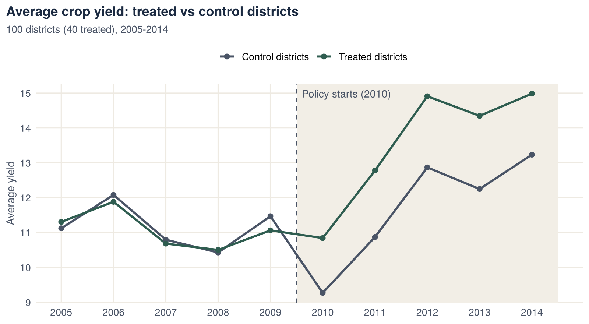
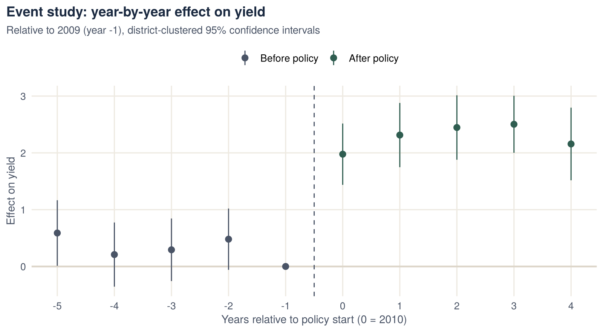
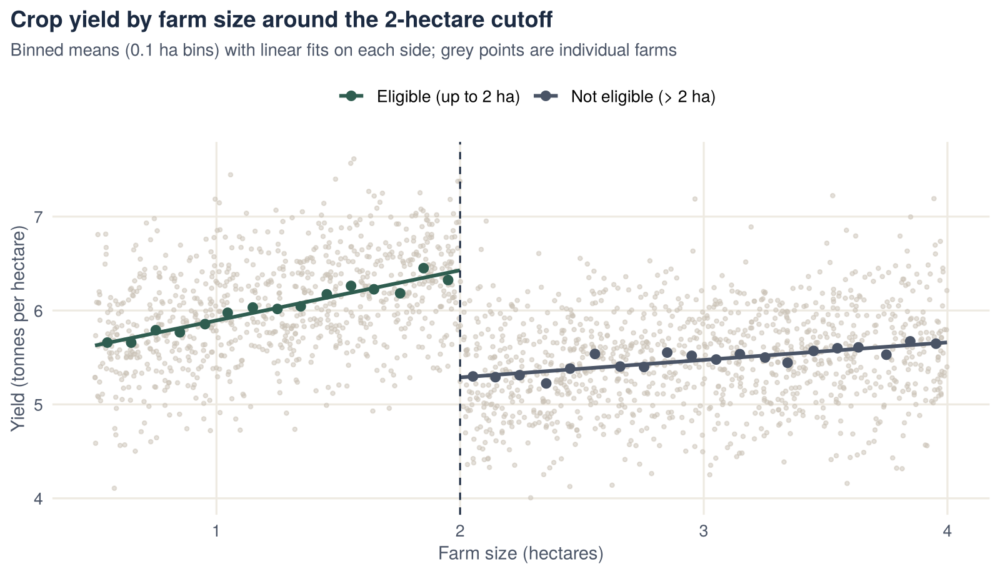

::: {.project-meta}
::: {}
[Context]{.k}

[MSc Econometrics, HU Berlin]{.v}
:::
::: {}
[Data]{.k}

[District panel (1,000 obs.) · farm cross-section (2,000)]{.v}
:::
::: {}
[Method]{.k}

[TWFE DiD, event study, sharp RDD]{.v}
:::
::: {}
[Tools]{.k}

[R · fixest · rdrobust · rddensity · ggplot2]{.v}
:::
:::

## Key findings

- **District policy (DiD):** treated districts' yields rose by **1.97 units** more than control districts' after the policy started (SE 0.14, p < 0.001).
- **Effect over time:** the effect appears in the first policy year and stays between 2.0 and 2.5 units in each of the five post-policy years.
- **Fertiliser subsidy (RDD):** farms just eligible for the subsidy (at most 2 ha) have yields about **1.06 tonnes per hectare higher** than farms just above the cutoff (95% CI 0.85 to 1.27). That is roughly 19% of average yield in the sample.
- **Robustness:** the RDD estimate barely changes when the bandwidth is halved or increased by half. The density test finds no sign that farmers manipulated their reported farm size to qualify.

## Research question

Agricultural policies are rarely assigned at random, so simply comparing participants with non-participants mixes the policy effect with pre-existing differences. The project applies two standard quasi-experimental designs that recover causal effects from observational data:

1. **Difference-in-differences:** a policy introduced in 2010 in 40 of 100 districts. Did it raise yields in the treated districts?
2. **Regression discontinuity:** a fertiliser subsidy available only to farms of up to 2 hectares. What is the subsidy's effect on yield for farms near the cutoff?

## Part A: Difference-in-differences

### Data and checks

The data are a balanced panel of **100 districts observed from 2005 to 2014**. 40 districts are treated, and the policy starts in 2010. Before estimating, I checked that:

- there is exactly one observation per district and year;
- treatment status never changes within a district;
- the post-period indicator switches on in 2010 for all districts.

### Method

The model is a two-way fixed-effects regression:

$$
\text{yield}_{dt} = \alpha_d + \lambda_t + \delta \,(\text{Treated}_d \times \text{Post}_t) + \varepsilon_{dt}
$$

- **District fixed effects** $\alpha_d$ absorb permanent differences between districts, such as soil quality.
- **Year fixed effects** $\lambda_t$ absorb shocks common to all districts, such as weather or prices.
- $\delta$ is the DiD estimate.
- Standard errors are clustered by district, because yields in the same district are correlated over time.

### Results

| | Estimate | Clustered SE | p-value |
|---|---:|---:|---:|
| Treated × Post (DiD effect) | **1.965** | 0.142 | < 0.001 |

[District and year fixed effects included; 1,000 observations, 100 clusters.]{.muted style="font-size:.88rem"}

A simple comparison of group means gives the same picture:

| Average yield | Before 2010 | From 2010 | Change |
|---|---:|---:|---:|
| Treated districts | 11.09 | 13.57 | +2.49 |
| Control districts | 11.18 | 11.70 | +0.52 |
| **Difference** | | | **+1.97** |

{fig-alt="Average yield by year for treated and control districts; the lines track each other before 2010 and diverge afterwards."}

### Event study

The event study replaces the single DiD estimate with a separate effect for each year, measured relative to 2009. It serves two purposes:

- **Pre-trends test:** the estimates for the years before 2010 should be close to zero if treated and control districts were on similar paths.
- **Dynamics:** the estimates from 2010 onward show how the effect evolves over time.

{fig-alt="Event-study coefficients: small pre-policy estimates and effects of about 2 to 2.5 after 2010."}

| Years relative to 2010 | −5 | −4 | −3 | −2 | 0 | 1 | 2 | 3 | 4 |
|---|---:|---:|---:|---:|---:|---:|---:|---:|---:|
| Estimate | 0.59 | 0.21 | 0.29 | 0.48 | 1.98 | 2.31 | 2.45 | 2.50 | 2.16 |
| p-value | 0.05 | 0.47 | 0.30 | 0.08 | <0.001 | <0.001 | <0.001 | <0.001 | <0.001 |

Three of the four pre-policy estimates are small and not significant. The estimate five years before the policy is borderline (p ≈ 0.05). Every post-policy estimate is large and highly significant, so the effect persists rather than fading.

## Part B: Regression discontinuity

### Setting

The government offers a fertiliser subsidy to farms with **at most 2 hectares** of cultivated land.

- **Running variable:** farm size. Eligibility depends only on whether farm size is at or below 2 ha, so the design is a **sharp RDD**.
- **Data:** 2,000 farms, of which 860 are eligible.
- **Outcome:** crop yield in tonnes per hectare.

Farms just below and just above 2 ha should be similar in everything except subsidy receipt. The jump in yield at the cutoff therefore measures the subsidy's effect for farms near 2 ha.

### Method

I estimated the effect with local linear regression on each side of the cutoff:

- triangular kernel;
- bandwidth chosen to minimise the mean squared error (MSE-optimal), which is about 0.49 ha here;
- robust bias-corrected confidence intervals (`rdrobust`).

I then checked that the result holds with a narrower and a wider bandwidth. Finally, I tested for bunching of farms just below the cutoff (`rddensity`), which would suggest that farm sizes were misreported to gain eligibility.

{fig-alt="Yield against farm size: a clear downward jump at the 2-hectare cutoff from eligible to non-eligible farms."}

### Results

`rdrobust` reports the jump from the eligible side (left of the cutoff) to the non-eligible side (right), so a negative estimate means eligible farms have higher yields.

| Bandwidth | Farms used | Estimate (eligible → not eligible) | Robust 95% CI |
|---|---:|---:|---|
| MSE-optimal (0.49 ha) | 579 | **−1.06** | [−1.27, −0.85] |
| Narrow (0.25 ha) | 309 | −0.98 | [−1.41, −0.55] |
| Wide (0.75 ha) | 887 | −1.06 | [−1.27, −0.84] |

| Manipulation test (rddensity) | T-statistic | p-value |
|---|---:|---:|
| Density of farm size at 2 ha | −1.29 | 0.20 |

## Economic interpretation

- **District policy.** In this dataset, the policy raised yields by about 2 units, an increase of roughly 18% over the treated districts' pre-policy average. The effect appears in the first year and persists. This suggests a lasting productivity effect rather than a one-off response. The trend plot and the mostly flat pre-policy estimates support the parallel-trends assumption. The borderline estimate five years before the policy is the one point to keep in mind.
- **Fertiliser subsidy.** For farms near the 2-hectare threshold, the subsidy increases yield by about 1 tonne per hectare. The estimate is stable across bandwidths. There is no bunching below the cutoff, which supports the assumption that farms could not sort themselves into eligibility.
- **Policy relevance.** The two designs answer the questions policymakers typically ask about agricultural programmes:
  - Did the programme work?
  - How quickly did it take effect, and did the effect last?
  - Would raising or lowering an eligibility threshold change outcomes for the farms affected?

## What this project demonstrates

- Designing a causal evaluation using two different quasi-experimental methods.
- Estimating two-way fixed-effects DiD with clustered inference, and testing parallel trends with an event study.
- Running a sharp RDD with modern robust inference, bandwidth sensitivity checks and a manipulation test.
- Turning estimates into clear statements about policy effects.

## Code

Full analysis script: [`did_rdd.R`](scripts/did_rdd.R)

[The datasets were provided for the course and are not redistributed here.]{.muted style="font-size:.88rem"}
