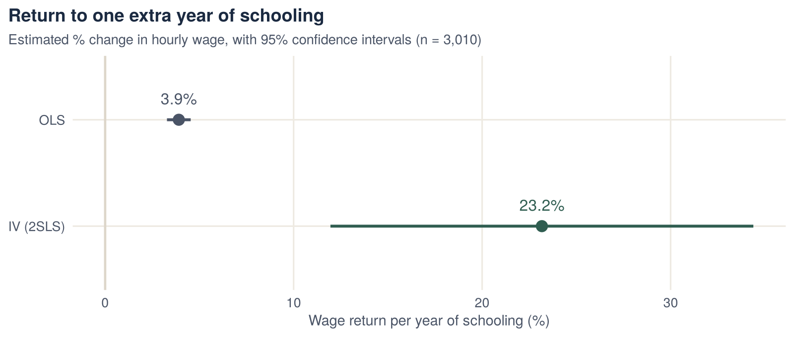

::: {.project-meta}
::: {}
[Context]{.k}

[MSc Econometrics, HU Berlin]{.v}
:::
::: {}
[Data]{.k}

[Card (1995), 3,010 US men]{.v}
:::
::: {}
[Method]{.k}

[OLS, first stage, 2SLS, IV diagnostics]{.v}
:::
::: {}
[Tools]{.k}

[R · AER · ggplot2]{.v}
:::
:::

## Key findings

- **OLS estimate:** each extra year of schooling is associated with **3.9% higher wages**.
- **IV (2SLS) estimate:** using college proximity as an instrument, the return rises to **23.2% per year** (95% CI 12% to 34%).
- **Instrument strength:** growing up near a four-year college raises schooling by **0.41 years**. The instrument passes the weak-instrument test (F = 20.9, above the rule-of-thumb threshold of 10).
- **Endogeneity:** the Wu–Hausman test rejects that schooling is exogenous (p < 0.001), so the OLS and IV estimates differ significantly.

## Research question

Estimating the return to education is a core problem in labour and development economics, and it matters for decisions on public investment in schooling. A simple regression of wages on years of schooling is likely biased, for two main reasons:

- **Omitted variables:** unobserved ability and motivation affect both how long people stay in school and how much they earn.
- **Measurement error:** errors in reported schooling bias the estimate towards zero.

The project tests whether these problems matter and corrects for them with an instrumental variable.

## Data

The data are Card's (1995) extract of the US National Longitudinal Survey of Young Men. **3,010 men** have complete information.

| Variable | Description |
|---|---|
| `lwage76` | Log hourly wage, 1976 (outcome) |
| `ed76` | Years of schooling, 1976 (endogenous regressor) |
| `nearc4` | Grew up near a four-year college (instrument) |
| `black`, `south66` | Race; lived in the South in 1966 |
| `daded`, `momed`, `famed` | Father's and mother's education; family education category |

## Methodology

**Instrument.** Growing up near a four-year college lowers the cost of studying. It should therefore increase schooling, which is the **relevance** condition. It should affect wages only through schooling, which is the **exclusion restriction**.

**Estimation steps:**

1. **OLS** of log wage on schooling and controls, as the baseline.
2. **First stage:** schooling regressed on the instrument and controls, to test instrument strength.
3. **Reduced form:** log wage regressed directly on the instrument.
4. **2SLS:** schooling is replaced by its first-stage prediction.

$$
\text{First stage:}\quad \text{educ}_i = \pi_0 + \pi_1 \,\text{nearc4}_i + X_i'\gamma + v_i
$$

$$
\text{Second stage:}\quad \ln w_i = \beta_0 + \beta_1 \,\widehat{\text{educ}}_i + X_i'\delta + u_i
$$

## Results

### First stage and reduced form

| | Coefficient on `nearc4` | SE | t |
|---|---:|---:|---:|
| First stage (outcome: years of schooling) | 0.407 | 0.087 | 4.69 |
| Reduced form (outcome: log wage) | 0.099 | 0.017 | 5.89 |

[The first stage uses all 3,613 men with schooling data; the reduced form uses the 3,010 men with wage data.]{.muted style="font-size:.88rem"}

Men who grew up near a four-year college have about 0.4 more years of schooling and about 10% higher wages. The IV estimate is approximately the ratio of these two effects.

### OLS vs. 2SLS

| | OLS | 2SLS |
|---|---:|---:|
| Years of schooling | **0.039**\*\*\* (0.003) | **0.232**\*\*\* (0.057) |
| Black | −0.192*** | −0.100* |
| Lived in the South (1966) | −0.130*** | −0.052 |
| Father's education | 0.001 | −0.019* |
| Mother's education | 0.009** | −0.017· |
| Family education category | 0.011* | 0.058*** |
| Observations | 3,010 | 3,010 |

[Standard errors in parentheses. \*\*\* p < 0.001, \*\* p < 0.01, \* p < 0.05, · p < 0.1.]{.muted style="font-size:.88rem"}

{fig-alt="Return to schooling: 3.9% by OLS with a narrow interval, 23.2% by IV with a wide interval."}

### IV diagnostics

| Test | Statistic | p-value | Conclusion |
|---|---:|---:|---|
| Weak instruments (first-stage F) | 20.93 | < 0.001 | Instrument is relevant and not weak |
| Wu–Hausman | 25.25 | < 0.001 | Schooling is endogenous, so OLS is inconsistent |

## Economic interpretation

- **OLS understates the return.** The IV estimate is much larger than OLS. This suggests that measurement error, or differences in who gains most from schooling, bias the OLS estimate downward.
- **A local effect.** The IV estimate is a *local* average treatment effect. It measures the return for men whose schooling decision was influenced by living near a college, for example those from families facing higher costs of education. For these men the return to an extra year appears to be high.
- **Precision.** The IV estimate is much less precise than OLS: its confidence interval is about 18 times wider. This is the usual cost of instrumental variables. Even so, the lower end of the interval is about three times the OLS estimate.
- **Policy relevance.** The results support policies that lower the cost of attending further education, such as access to local colleges. The returns appear largest for people at the margin of continuing their studies.

## What this project demonstrates

- Recognising an endogeneity problem and explaining where the bias comes from.
- Choosing an instrument and arguing that it is relevant and satisfies the exclusion restriction.
- Running the full IV workflow in R: first stage, reduced form, 2SLS, weak-instrument and Wu–Hausman tests.
- Interpreting an IV estimate correctly as a local effect.

## Code

Full analysis script: [`iv_returns_to_schooling.R`](scripts/iv_returns_to_schooling.R)

[Reference: Card, D. (1995). Using geographic variation in college proximity to estimate the return to schooling. In *Aspects of Labour Market Behaviour*, University of Toronto Press.]{.muted style="font-size:.88rem"}
