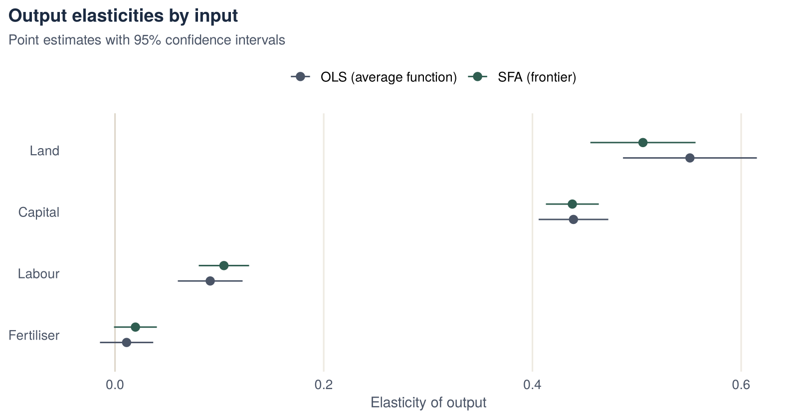
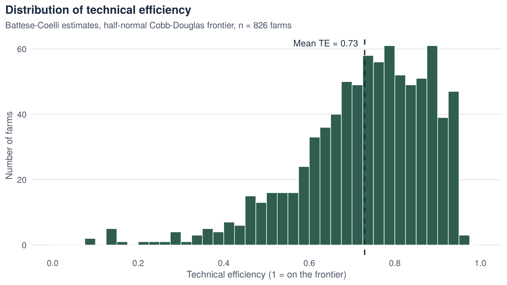
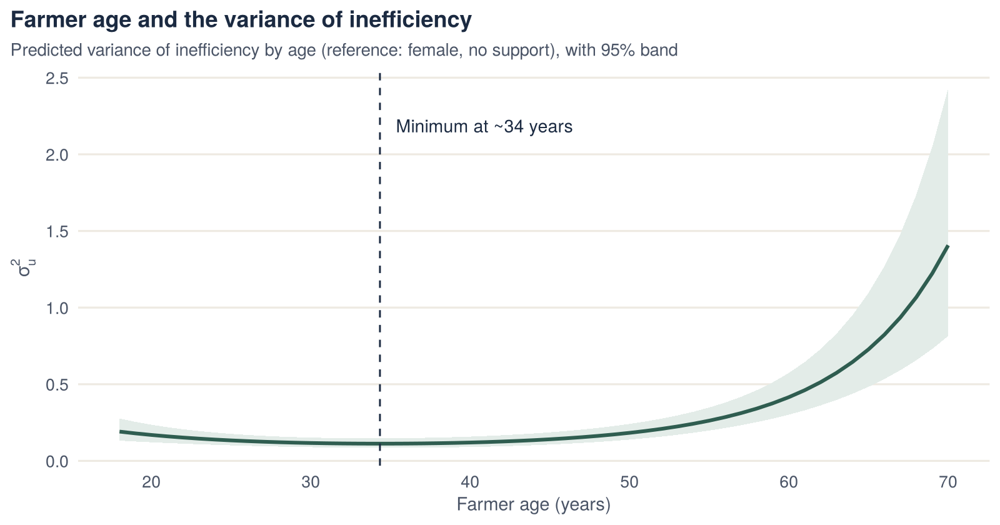

::: {.project-meta}
::: {}
[Context]{.k}

[MSc Econometrics, HU Berlin]{.v}
:::
::: {}
[Data]{.k}

[Cross-section, 826 sunflower farms]{.v}
:::
::: {}
[Method]{.k}

[Stochastic frontier, MLE]{.v}
:::
::: {}
[Tools]{.k}

[R · sfaR · car · lmtest · ggplot2]{.v}
:::
:::

## Key findings

- **Average technical efficiency is 0.73.** With the same inputs, the typical farm produces about 73% of the output of a best-practice farm.
- **Most of the deviation from the frontier is inefficiency, not random noise.** About 94% of the variance of the composite error is due to inefficiency (γ = 0.94).
- **Land and capital drive output.** Their output elasticities are 0.51 and 0.44. Labour contributes less (0.10), and fertiliser has no significant effect at the 5% level.
- **Returns to scale are slightly increasing (1.07).** Constant returns are rejected.
- **Farmer age is related to inefficiency in a U-shape,** with the lowest inefficiency at about 34 years. Gender and receiving policy support show no significant effect.

## Research question

Some farms produce less than others with the same land, capital, labour and fertiliser. The project asks how large this efficiency gap is across sunflower farms, and whether observable farmer characteristics explain it.

The question matters for agricultural policy. If farms are well below their frontier, better management, extension services or targeted support could raise output without extra inputs. Policy that only increases input use would not achieve this.

## Data

The project uses a cross-sectional course dataset of **826 sunflower farms** in three regions.

| Variable | Role |
|---|---|
| Total production | Output |
| Land, capital, labour, fertiliser | Production inputs |
| Age, age², gender | Farmer characteristics (inefficiency determinants) |
| Policy support (received / not received) | Policy variable (117 farms received support) |

**Preparation:**

- Input and output variables were checked for missing and non-positive values, since a log specification needs strictly positive data.
- All variables were then **log-transformed and normalised by their sample means.**
- With this normalisation, the estimated coefficients are output elasticities evaluated at the average farm.

## Methodology

**1. Baseline OLS.** A Cobb–Douglas production function was first estimated by OLS:

$$
\ln q_i = \beta_0 + \beta_L \ln \text{land}_i + \beta_K \ln \text{capital}_i + \beta_N \ln \text{labour}_i + \beta_F \ln \text{fertiliser}_i + \varepsilon_i
$$

OLS describes the *average* farm. It cannot separate inefficiency from random shocks.

**2. Stochastic production frontier.** The error is split into two parts:

$$
\varepsilon_i = v_i - u_i, \qquad v_i \sim N(0, \sigma_v^2), \qquad u_i \sim N^{+}(0, \sigma_u^2)
$$

- $v_i$ captures random noise, such as weather.
- $u_i \geq 0$ captures technical inefficiency, the shortfall from the frontier.

The model was estimated by maximum likelihood with a half-normal distribution for $u_i$ (`sfaR::sfacross`). Farm-level technical efficiency, $TE_i = E[\exp(-u_i)\mid\varepsilon_i]$, was computed with the Battese–Coelli estimator.

**3. Determinants of inefficiency.** The variance of inefficiency was modelled as a function of farmer characteristics:

$$
\sigma_{u,i}^2 = \exp(\delta_0 + \delta_1 \text{Age}_i + \delta_2 \text{Age}_i^2 + \delta_3 \text{Male}_i + \delta_4 \text{Support}_i)
$$

A positive $\delta$ means higher expected inefficiency. The two frontier models were compared with a likelihood-ratio test.

## Results

### Production elasticities

| | OLS | SFA frontier | SFA with determinants |
|---|---:|---:|---:|
| Land | 0.551*** | 0.506*** | 0.521*** |
| Capital | 0.439*** | 0.438*** | 0.434*** |
| Labour | 0.091*** | 0.104*** | 0.096*** |
| Fertiliser | 0.011 | 0.020· | 0.021* |
| **Returns to scale** | **1.093** | **1.068** | **1.072** |
| Log-likelihood | −238.2 | −128.0 | −76.5 |
| Observations | 826 | 826 | 826 |

[Significance: \*\*\* p < 0.001, \* p < 0.05, · p < 0.1. OLS R² = 0.84.]{.muted style="font-size:.88rem"}

{fig-alt="Output elasticities for land, capital, labour and fertiliser from OLS and SFA, with 95% confidence intervals."}

**Returns to scale.**

- OLS: the elasticities sum to 1.09. An F-test rejects constant returns to scale (F = 25.6, p < 0.001).
- Frontier model: the sum is 1.07 (SE 0.014), which also rejects constant returns (z = 4.7).
- If all inputs rise by 10%, frontier output rises by about 10.7%.

### Is there inefficiency?

| Statistic | Value | Meaning |
|---|---:|---|
| Skewness of OLS residuals | −2.41 | Negative skew, as expected when inefficiency is present |
| Coelli skewness test (z) | −28.3 | Significant at any conventional level |
| σ²u / σ²v | 0.215 / 0.0135 | Inefficiency variance far exceeds noise variance |
| γ = σ²u / (σ²u + σ²v) | 0.94 | 94% of error variance is due to inefficiency |
| LR test: SFA vs. OLS | 220.4 | Strongly rejects "no inefficiency" |

The OLS residuals are skewed and the likelihood improves substantially in the frontier model. Both results support the frontier specification over a plain average production function.

### Technical efficiency scores

{fig-alt="Histogram of technical efficiency scores; mean 0.73."}

| Mean | Median | Min | Max | Share ≥ 0.80 | Share < 0.50 |
|---:|---:|---:|---:|---:|---:|
| 0.73 | 0.75 | 0.08 | 0.96 | 37% | 8% |

Most farms lie between 0.65 and 0.85. There is a long lower tail: a small group of farms operates far below the frontier. These farms account for a large share of the potential output gain.

### Determinants of inefficiency

| Variable (effect on σ²u) | Estimate | p-value |
|---|---:|---:|
| Age | −0.137 | < 0.001 |
| Age² | 0.0020 | < 0.001 |
| Male (ref. female) | 0.135 | 0.27 |
| Received policy support | −0.107 | 0.50 |

**Likelihood-ratio test against the basic frontier:** LR = 103.0, df = 4, p < 0.001.

{fig-alt="Predicted variance of inefficiency by farmer age, U-shaped with a minimum near 34 years."}

## Economic interpretation

- **Scope for output gains.** The average farm uses its inputs at about 73% of best practice. Moving farms to the frontier could raise output considerably without additional land or capital. The gain would be largest for the low-efficiency tail.
- **Land and capital matter most.** Output responds most strongly to land and capital. Fertiliser's marginal contribution is close to zero at current use levels. This could mean fertiliser is already used near saturation, or is measured imprecisely.
- **Mild economies of scale.** Returns to scale are slightly increasing, so larger farms have a small productivity advantage.
- **Age effect.** Inefficiency falls with age up to about 34 and rises after that. One possible reading: experience helps up to a point, after which older farmers may adopt new practices more slowly. This is an interpretation, not a tested mechanism.
- **Policy support.** Farms that received support are not detectably more efficient, and their mean efficiency is about the same as other farms' (0.74 vs. 0.73). Support was not randomly assigned, so this result is not a causal evaluation of the policy.

## Limitations

- **Functional form.** Cobb–Douglas imposes constant elasticities. A translog frontier would allow them to vary but was not estimated.
- **Distributional assumption.** Efficiency scores depend on the half-normal assumption for inefficiency. Other distributions, such as truncated-normal or exponential, could shift the levels.
- **Cross-section.** With a single period, persistent inefficiency cannot be separated from unobserved farm heterogeneity, such as soil quality.
- **Policy variable.** Selection into support is not controlled for, so its coefficient is an association, not an effect.

## What this project demonstrates

- Specifying and estimating a stochastic frontier model by maximum likelihood in R.
- Diagnosing whether a frontier model is warranted, using residual skewness, variance decomposition and LR tests.
- Testing economic hypotheses, such as returns to scale.
- Turning estimates into economic and policy-relevant interpretation, with honest limitations.

## Code

The full analysis script: [`sfa_sunflower.R`](scripts/sfa_sunflower.R)

[The dataset was provided for the course and is not redistributed here.]{.muted style="font-size:.88rem"}
