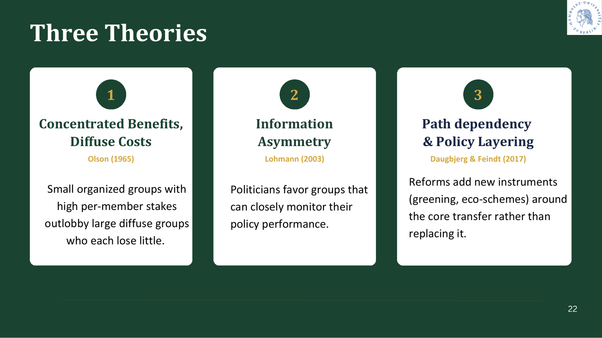
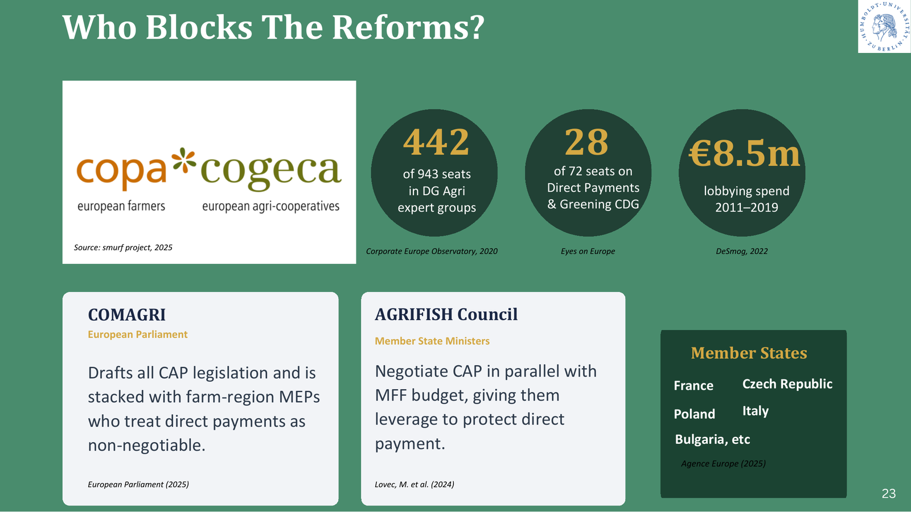
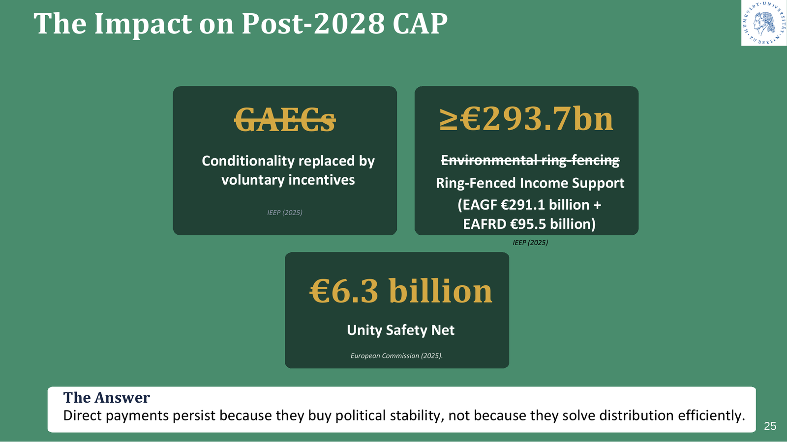

::: {.project-meta}
::: {}
[Context]{.k}

[MSc Agricultural Economics, HU Berlin]{.v}
:::
::: {}
[Type]{.k}

[Group project (5 students)]{.v}
:::
::: {}
[Method]{.k}

[Literature review · policy analysis]{.v}
:::
::: {}
[Grade]{.k}

[**1.3** (German scale, 1.0 = best)]{.v}
:::
:::

::: {.contribution}
**Group work and my contribution.** The group produced a 34-slide presentation and divided the research by section:

- Sryashee Dutta Roy: introduction, and reforms and their efficacy
- Jiaxi Meng: the evolution of direct payments
- Pallavi Lokesh: the future of the CAP after 2028
- Muhammad Ilham Haeri: who benefits from direct payments

**My individual contribution:** Section 5, *"Why are direct payments still continuing?"* (slides 21–25). I researched and presented the political economy of the CAP: the theories that explain why the instrument persists, the actors who block reform, the effect of the 2023–24 farmer protests, and what this means for the post-2028 CAP.
:::

## Key findings

- **Direct payments are the core of the CAP.** They account for about **70% of the CAP budget**, more than €37 billion paid to EU farmers each year.
- **Much of the money does not stay with farmers.** Decoupled payments are partly capitalised into land: land rents rise by 9–55% and land values by 154–164%. Around half of EU farmland is rented, so landowners capture part of the transfer.
- **The money is highly concentrated.** Roughly **78% of direct payments go to the top 20% of beneficiaries** (European Court of Auditors, 2020).
- **Direct payments persist for political reasons** *(my section)*. They are kept because they buy political stability, not because they redistribute income efficiently.
- **Recent reforms change the amount, not the mechanism.** Redistributive payments improved the distribution of payments in Italy: the Gini index fell from 0.626 to 0.530. But capitalisation into land rents and the concentration of farm income remain.

## Research question

Direct payments are income transfers paid to farmers under Pillar I of the EU's Common Agricultural Policy (CAP). Since their introduction in the 1992 MacSharry reform, a large body of research has criticised them as poorly targeted. They are linked to land rather than to need, and much of the benefit goes to landowners. The project asked:

1. How have direct payments evolved, and where is the policy heading after 2028?
2. Are farmers the sole beneficiaries of direct payments?
3. **If direct payments are an inefficient way to support farm incomes, why does every reform round keep them?** *(my section)*
4. Have the EU's reforms improved how fairly and effectively payments are distributed?

## Background and policy relevance

The CAP is one of the EU's largest spending programmes. Each reform round has added new objectives to direct payments while keeping the payments themselves:

| Reform | Change to direct payments |
|---|---|
| **1992 MacSharry** | Price support cut (−35% for cereals). Direct payments introduced as compensation, under GATT Uruguay Round pressure |
| **2003 Fischler** | Decoupling: the Single Farm Payment based on historical entitlements, not current output |
| **2013 Cioloș** | "Greening": 30% of payments tied to crop diversification, grassland and ecological focus areas |
| **2021 / 2023–27** | Basic Income Support for Sustainability, compulsory redistribution and degressivity, eco-schemes (25% of the budget), enhanced conditionality |
| **Post-2028 proposal** | One payment system with a single fund, capping at €100k per farm, a €130–240/ha floor–ceiling, eco-schemes losing their ring-fenced 25% share |

The post-2028 negotiations were ongoing when we presented. Ministers remained split on capping, the floor–ceiling range and the exclusion of pensioners. The question of who benefits and why the system persists is therefore directly relevant to current policy.

## Literature review and main findings

### Who benefits? Capitalisation and concentration

- **Capitalisation into land.** Ciaian, Baldoni and Kancs (2023) and the meta-analysis by Varacca et al. (2022) find that decoupled payments are substantially capitalised into land rents and values.
- **Landowners' share rose after 2013.** After the 2013 reform, the share of decoupled payments captured by landowners rose from 17% to 25%, the opposite of what the reform intended.
- **Concentration.** Payments are highly concentrated among the largest beneficiaries (European Court of Auditors, 2020). In several Member States the top 1% of recipients receive up to 30–40% of payments.
- **Structural change.** Between 2007 and 2022, the EU lost 44% of its small commercial farms, while the number of very large farms grew by 56%.

### Why do direct payments persist? *(my section)*

I structured the argument around three political-economy theories:

1. **Concentrated benefits, diffuse costs (Olson, 1965).** Farmers are a small, well-organised group with a lot at stake per person. Taxpayers and consumers each lose little and rarely organise, so the farm lobby outweighs them.
2. **Information asymmetry (Lohmann, 2003).** Politicians favour groups that can closely monitor how a policy affects them. Farm organisations follow every CAP detail; the general public does not.
3. **Path dependency and policy layering (Daugbjerg & Feindt).** Reforms add new instruments, such as greening and eco-schemes, *around* the core income transfer instead of replacing it.

{fig-alt="Slide: three theories: concentrated benefits and diffuse costs (Olson), information asymmetry (Lohmann), path dependency and policy layering (Daugbjerg & Feindt)."}

I then identified the actors who block reform:

- **Farm lobby.** Copa-Cogeca is strongly represented in Commission expert groups and has spent heavily on lobbying.
- **European Parliament.** Its agriculture committee (COMAGRI) has many members from farming regions.
- **Agriculture Council.** Member State ministers negotiate the CAP in parallel with the EU budget, which gives them leverage to protect direct payments.

{fig-alt="Slide: the actors who block reform: Copa-Cogeca, COMAGRI, AGRIFISH Council and Member States."}

Finally, I analysed the **2023–2024 farmer protests**. The protests exposed rural discontent and the electoral risk it carries, which raised the political value of income support. The European People's Party (EPP) repositioned itself as farmer-friendly, and the Commission relaxed environmental conditionality. The post-2028 proposal reflects this shift:

- income support is ring-fenced;
- environmental conditionality is replaced by voluntary incentives.

{fig-alt="Slide: impact on the post-2028 CAP: ring-fenced income support, Unity Safety Net, weaker conditionality."}

### Do the reforms work?

The EU's main responses are internal convergence, redistributive payments for the first hectares, capping and degressivity, and eco-schemes. For Italy, Pierangeli et al. (2025) show that the 2023–27 reform made payments fairer:

- the Gini index fell from 0.626 to 0.530;
- the quintile ratio narrowed from 8.4 to 5.2.

However, capitalisation into land rents and the concentration of farm income persist. Equalising *payments* is not the same as redistributing *income*.

## Analytical approach

The group combined three types of evidence:

- **Academic literature:** peer-reviewed studies on capitalisation, distribution and the political economy of the CAP.
- **Official and audit sources:** the European Commission, the European Court of Auditors, the European Parliament and the OECD.
- **Primary evidence:** a group member recorded comments from a DG AGRI director during a Brussels excursion in July 2026.

In my section, I applied political-economy theory to explain an outcome that efficiency arguments alone cannot. I then tested the explanation against the actors involved and against recent events, namely the farmer protests and the post-2028 proposal.

## Economic arguments

- **Incidence.** When payments are tied to land, part of the subsidy passes to whoever owns the scarce, fixed factor: land. This weakens direct payments as an income-support tool.
- **Targeting.** Paying per hectare sends most of the money to the largest holdings, even though the official goal is to support farmers' incomes where they are low.
- **Political equilibrium** *(my section)*. The economic case against direct payments is strong, but the political cost of removing them is high. The groups that gain are concentrated and organised, the losers are dispersed, and the institutions give farm interests a veto point. The status quo is therefore a stable political equilibrium.

## Policy implications

The group drew four implications from the literature:

1. **Phase out land-based payments** and link support to income rather than hectares (Runge et al., 2022; OECD, 2023).
2. **Redirect funds to environmental outcomes**, paying for performance rather than for land.
3. **Target genuine need** using income criteria (Pierangeli et al., 2025).
4. **Regulate land markets.** Without this, subsidies keep leaking to landowners (Ciaian et al., 2023).

From my section: reform proposals must address the **political economy**, not only the economics. Removing payments outright is unlikely to succeed. Reforms that compensate or re-target support are more likely to survive the decision process.

## Conclusions

- The CAP has undergone several reforms, but direct payments still take the largest share of the budget, and they are set to become even more important after 2028.
- Farmers are not the only beneficiaries: landowners and the largest holdings capture a large part of the payments.
- Direct payments persist because they buy political stability, not because they redistribute income efficiently.
- The structural criticism applies to every reform round: the amount can be adjusted, but the mechanism stays the same.

## Presentation

[Download the full presentation (PDF, 34 slides)](files/direct-payments-cap-presentation.pdf){.btn-solid}

## Key literature

The ten main sources from our bibliography:

1. Ciaian, P., Baldoni, E., & Kancs, D. (2023). The capitalisation of CAP subsidies into land prices in the EU. *Land Use Policy*, 133, 106855. <https://doi.org/10.1016/j.landusepol.2023.106855>
2. Ciaian, P., Baldoni, E., Kancs, D., & Drabik, D. (2021). The capitalisation of agricultural subsidies into land prices. *Annual Review of Resource Economics*, 13, 17–38. <https://doi.org/10.1146/annurev-resource-102020-100625>
3. Varacca, A., Guastella, G., Pareglio, S., & Sckokai, P. (2022). A meta-analysis of the capitalisation of CAP direct payments into land prices. *European Review of Agricultural Economics*, 49(2), 359–382. <https://doi.org/10.1093/erae/jbab014>
4. Pierangeli, F., Biagini, L., Pupo D'Andrea, M. R., Severini, S., & Sorrentino, A. (2025). The CAP direct payments reform 2023–2027 in Italy: A path to fairer redistribution? *Agricultural and Food Economics*, 13, 39. <https://doi.org/10.1186/s40100-025-00384-4>
5. Frascarelli, A., Ciliberti, S., Bartolucci, P. E., & Mastandrea, G. (2025). The CAP coherence between redistributive and environmental goals: Do the allocation criteria for direct payments play a role? *Agricultural and Food Economics*, 13, 15. <https://doi.org/10.1186/s40100-025-00356-8>
6. Swinnen, J. (Ed.). (2015). *The political economy of the 2014–2020 Common Agricultural Policy: An imperfect storm*. Rowman & Littlefield International.
7. Daugbjerg, C., & Feindt, P. H. (2022). Post-exceptionalism in the Common Agricultural Policy. In J. Tosun & P. Graziano (Eds.), *Encyclopedia of EU Public Policy* (pp. 283–291). Edward Elgar.
8. Cunha, A., & Swinbank, A. (2011). *An inside view of the CAP reform process: Explaining the MacSharry, Agenda 2000, and Fischler reforms*. Oxford University Press.
9. European Court of Auditors. (2020). *Future of the Common Agricultural Policy*. Briefing paper.
10. OECD. (2023). *Agricultural policy monitoring and evaluation 2023*. OECD Publishing.
