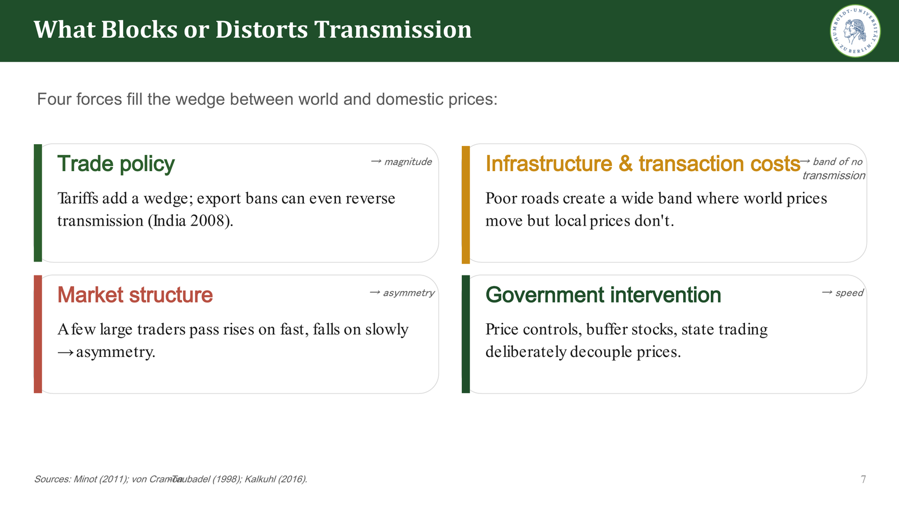
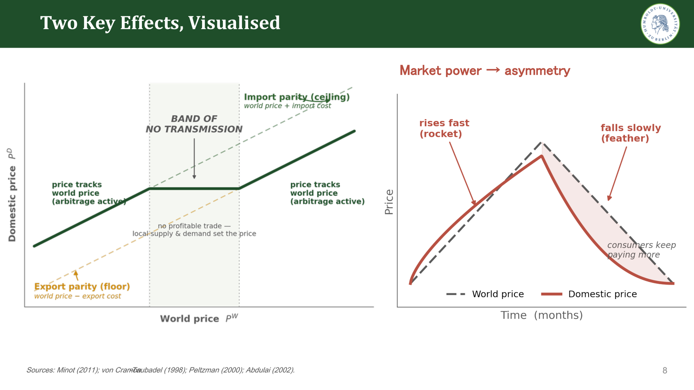
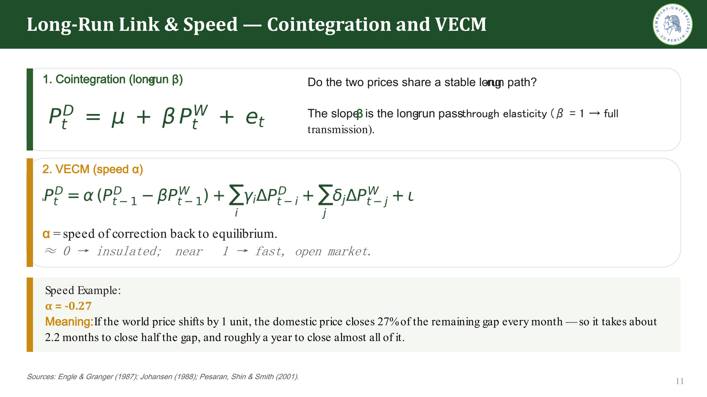
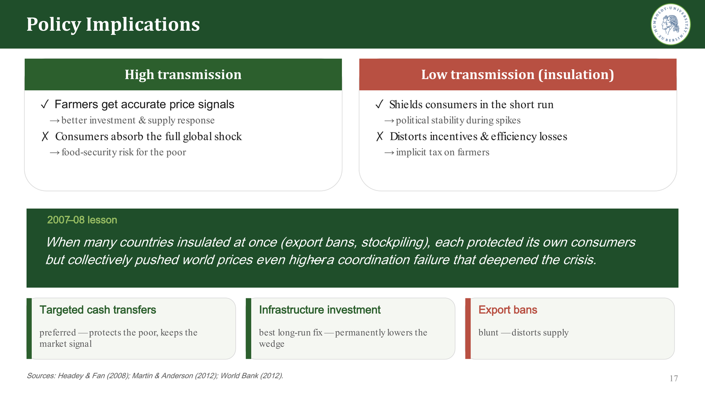

::: {.project-meta}
::: {}
[Context]{.k}

[MSc Agricultural Economics, HU Berlin]{.v}
:::
::: {}
[Type]{.k}

[Group project (2 students)]{.v}
:::
::: {}
[Method]{.k}

[Literature review · econometric methods review]{.v}
:::
::: {}
[Topic]{.k}

[Agricultural markets · food security]{.v}
:::
:::

::: {.contribution}
**Group work and my contribution.** This was a group project of two students. The other member prepared the opening part (slides 1–6): the motivation, world prices and spatial arbitrage, the Law of One Price, and the three dimensions of transmission.

**My individual contribution (Bipin Joshi):** everything from *"What blocks or distorts transmission"* to the end (slides 7–19). This covers:

- the barriers to transmission and the country typology;
- the econometric toolbox for measuring transmission;
- CGE models and the empirical evidence;
- supply and household welfare effects;
- the policy implications and conclusions.
:::

## Key findings

- **Transmission is partial.** In the studies we reviewed, the long-run pass-through of world prices to domestic food prices in developing countries ranges from about **0.2 to 0.9**. It is rarely complete.
- **Adjustment is slow and often asymmetric.** Price rises tend to be passed on faster than price falls ("rockets and feathers").
- **Trade exposure matters most.** Countries that import consistently and countries with open trade regimes see high transmission. Isolated or heavily intervening economies see little.
- **The welfare cost falls on net buyers of food.** Commercial farmers who are net sellers gain from price rises. The urban poor and landless households, who spend 40–75% of their budget on food, lose.
- **Instruments matter for policy.** Targeted cash transfers protect the poor without distorting price signals. Export bans insulate one country but push world prices higher for everyone else.

## Research question

During the 2007–08 food-price crisis, world food prices rose by about 83%. Around 70% of developing countries are net food importers, and poor households spend a large share of their income on food. Whether and how fast world price shocks reach local markets is therefore central to food security and agricultural policy. The project asked:

1. **How does transmission work?** Arbitrage and the Law of One Price.
2. **Why is it incomplete?** Trade policy, transaction costs, market power and government intervention.
3. **Who does it affect?** Producers, consumers and household welfare.

## Background: the benchmark

In a frictionless, competitive market, the **Law of One Price** links the domestic price to the world price:

$$
P^D_t = E_t \, P^W_t (1 + \tau) + c
$$

Here $E$ is the exchange rate, $\tau$ the tariff and $c$ the transport and trade costs. Transmission has three dimensions:

- **Magnitude:** the transmission elasticity $\varepsilon$, where $\varepsilon = 1$ means full pass-through.
- **Speed:** how quickly the domestic price closes the gap after a shock.
- **Asymmetry:** whether price rises and falls are transmitted equally.

## What blocks or distorts transmission *(my section)*

The literature identifies four forces that create a wedge between world and domestic prices. Each affects a different dimension of transmission:

| Force | Main effect | Mechanism |
|---|---|---|
| **Trade policy** | Magnitude | Tariffs add a wedge; export bans can even reverse transmission (India, 2008) |
| **Infrastructure and transaction costs** | Band of no transmission | High transport costs create a range in which world prices move but local prices do not |
| **Market structure** | Asymmetry | A few large traders pass on price rises quickly and price falls slowly |
| **Government intervention** | Speed | Price controls, buffer stocks and state trading deliberately decouple prices |

{fig-alt="Slide: trade policy, infrastructure and transaction costs, market structure, and government intervention."}

{fig-alt="Slide: diagrams of the price band between export and import parity, and rockets-and-feathers asymmetry."}

**Country typology.** A country's trade exposure and policy stance largely determine how much is transmitted:

| Category | Examples | Expected transmission |
|---|---|---|
| Free traders | Brazil, South Africa | High: weak insulation |
| Exporting stabilisers | China, India, Vietnam | Low: strong policy buffers |
| Consistent importers | Bangladesh, Egypt, Kenya, Senegal | High: few stabilisation tools |
| Isolated economies | Ethiopia, Malawi, Nigeria, Zambia | Low: poorly integrated |

## Analytical approach: measuring transmission *(my section)*

Different questions require different econometric methods:

| Question | Method |
|---|---|
| Is there a stable long-run link, and how complete is pass-through ($\beta$)? | Cointegration and VECM |
| How fast does the gap close after a shock ($\alpha$)? | (Vector) error-correction model |
| Do rises and falls transmit differently ($\alpha^+$ vs. $\alpha^-$)? | Threshold ECM (TAR/M-TAR), NARDL |
| How does a shock spread month by month across countries? | (Panel) VAR with impulse responses |
| Does world price *uncertainty* spill over into local markets? | MGARCH-BEKK |

**Interpreting the speed of adjustment.** In an error-correction model, $\alpha$ measures how quickly the domestic price corrects towards its long-run relationship with the world price. With $\alpha = -0.27$, the domestic price closes 27% of the remaining gap each month. Half the gap is closed after about 2.2 months, and nearly all of it after about a year.

{fig-alt="Slide: cointegration equation and VECM specification with an interpretation of α = −0.27."}

**Economy-wide effects.** $\beta$ and $\alpha$ describe a single price link. Computable general equilibrium (CGE) models instead trace a world-price shock through the whole economy, including distributional, macroeconomic and welfare effects. According to Siddig and Grethe (2014), pass-through in a CGE model depends on:

- the trade share;
- the sector's size in the economy;
- the Armington and CET substitution elasticities between imported and domestic goods;
- factor mobility across sectors;
- the exchange-rate regime.

## Main findings from the literature *(my section)*

- **Evidence across commodities.** Using a panel VAR for 23 countries, Emediegwu and Rogna (2024) find strong and almost immediate transmission for maize, rice and wheat. They find no significant transmission for sorghum, a crop that is hardly traded internationally.
- **Variation across countries.** Indicative estimates in the literature range from low pass-through for maize in Sub-Saharan Africa and for Ethiopian teff (insulated) to high pass-through for imported rice in Ghana. Several cases show faster transmission of price rises (Rapsomanikis et al., 2006; Minot, 2011; Kalkuhl, 2016).
- **Supply response.** Farmers react only to the share of the world price that actually reaches them. The observed supply response is therefore the product of the transmission elasticity and the farmers' own price response. Planted area adjusts in the next planting cycle; input use and yields adjust within the season.
- **Household welfare.** Following Deaton (1989), the first-order effect of a price change on a household is:

$$
\frac{\Delta W_h}{Y_h} \approx (\phi^S_h - \phi^C_h) \times \%\Delta P
$$

Here $\phi^S_h$ is the household's income share from selling the food and $\phi^C_h$ its budget share for buying it. Net sellers gain from price rises, subsistence farmers are roughly unaffected, and net buyers lose. In the short run poverty rises, because net buyers dominate among the poor. In the long run, adjustments in wages and output partly offset the loss (Ivanic & Martin, 2008).

## Policy implications *(my section)*

| | Advantages | Disadvantages |
|---|---|---|
| **High transmission** | Farmers receive accurate price signals, which supports investment and supply response | Consumers absorb the full global shock, a food-security risk for the poor |
| **Low transmission (insulation)** | Shields consumers in the short run, supporting political stability during price spikes | Distorts incentives and acts as an implicit tax on farmers |

**Lesson from 2007–08.** Many countries insulated their markets at the same time, through export bans and stockpiling. Each protected its own consumers, but together they pushed world prices even higher. This coordination failure deepened the crisis (Martin & Anderson, 2012).

**Preferred instruments:**

- **Targeted cash transfers** protect poor households while keeping the market signal.
- **Infrastructure investment** is the best long-run fix, because it permanently lowers the wedge.
- **Export bans** are a blunt tool that distorts supply.

{fig-alt="Slide: trade-offs of high vs low transmission, the 2007–08 lesson, and preferred policy instruments."}

## Conclusions

- World price shocks reach domestic food prices in developing countries only partially (pass-through of roughly 0.2–0.9) and with a meaningful delay.
- Adjustment is slow and often asymmetric.
- Both the strength and the speed of transmission depend mainly on trade exposure and on policy.
- The welfare cost of price spikes falls hardest on net food-buying households. Policy should protect them directly rather than suppress price signals.

## Presentation

[Download the full presentation (PDF, 19 slides)](files/price-transmission-presentation.pdf){.btn-solid}

## Key literature

The ten main sources from our reference list:

1. Rapsomanikis, G., Hallam, D., & Conforti, P. (2006). Market integration and price transmission in selected food and cash crop markets of developing countries. *FAO Commodity Market Review*.
2. Minot, N. (2011). *Transmission of world food price changes to markets in Sub-Saharan Africa*. IFPRI Discussion Paper 01059.
3. Emediegwu, L., & Rogna, M. (2024). Agricultural commodities' price transmission. *Food Policy*, 126.
4. von Cramon-Taubadel, S. (1998). Estimating asymmetric price transmission with the error correction representation. *European Review of Agricultural Economics*, 25(1).
5. Kalkuhl, M. (2016). Global commodity prices in developing countries. *Quarterly Journal of International Agriculture*, 55(4).
6. Siddig, K., & Grethe, H. (2014). Price transmission in CGE models. *Economic Modelling*, 38, 12–22.
7. Deaton, A. (1989). Rice prices and the distribution of income in Thailand. *Economic Journal*, 99.
8. Ivanic, M., & Martin, W. (2008). Implications of higher global food prices for poverty in low-income countries. *Agricultural Economics*, 39.
9. Headey, D., & Fan, S. (2008). Anatomy of a crisis: The causes and consequences of surging food prices. *Agricultural Economics*, 39(S1).
10. Martin, W., & Anderson, K. (2012). Export restrictions and price insulation during commodity price booms. *American Journal of Agricultural Economics*, 94(2).
